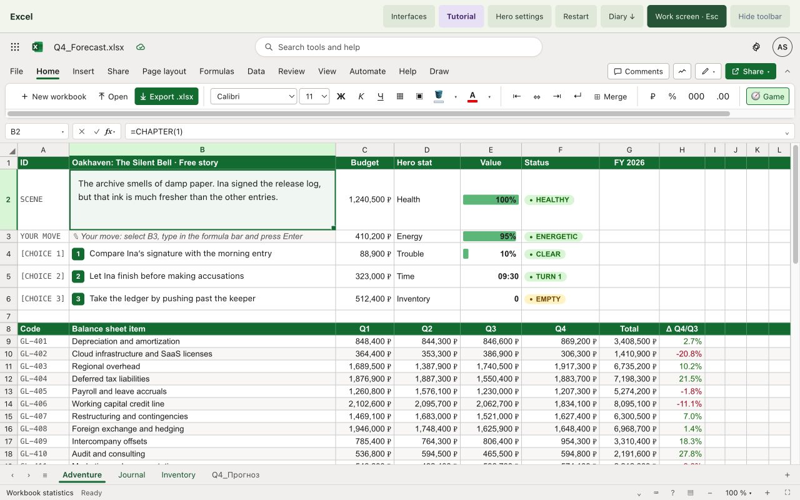
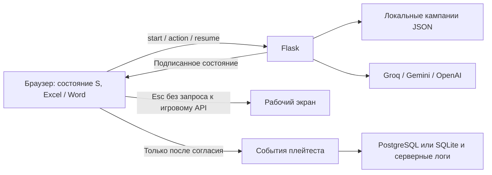

<div align="center">
  
  <h1>TabEscape</h1>
  <p><strong>История на несколько свободных минут</strong></p>
  <p>Браузерная RPG · 8 бесплатных историй · Excel и Word · RU / EN</p>
  <p><a href="https://tabescape.onrender.com/">Играть</a> · <a href="docs/presentation/TabEscape-Pitch-Deck.pdf">10 слайдов PDF</a> · <a href="PITCH.md">Питч</a> · <a href="#плейтест">Плейтест</a></p>
  <a href="https://github.com/ruslan-berkin/project4businesscup2.0/actions/workflows/ci.yml"></a>
</div>

## За 30 секунд

У вас есть несколько минут между задачами. Или всё запланированное сделано, но рабочий день ещё идёт. **TabEscape предлагает небольшое приключение, которое легко прервать и продолжить.** Читайте сцены, выбирайте поступки, знакомьтесь с персонажами и узнавайте последствия решений.

Игра выглядит как знакомое офисное приложение. **Esc** открывает рабочий отчёт или документ; повторный Esc возвращает ту же сцену. Не нужны аккаунт, загрузка файла или собственный ключ ИИ. Это развлечение, а не рабочий инструмент и не средство скрывать посещение сайта от мониторинга.

**Первый покупатель — гипотеза:** офисный сотрудник 25–45 лет в США, которому уже нравятся детективы, RPG и интерактивные истории. Платит сам игрок за новые приключения, а не работодатель за продуктивность.



## Попробовать за минуту

1. Откройте **[tabescape.onrender.com](https://tabescape.onrender.com/)** и выберите **Excel**.
2. Нажмите **Start adventure / Начать игру**: бесплатная история уже выбрана. Обучение можно пройти или пропустить.
3. Прочитайте сцену и сделайте ход. Время, показатели и журнал изменятся.
4. Нажмите **Esc**: появится заполненный Q4-отчёт. Повторный Esc вернёт ту же сцену.
5. Перезагрузите страницу → выберите интерфейс → **Continue / Продолжить**. Сохранённая партия продолжится без нового хода.
6. Через выбор интерфейса откройте **Word → Продолжить**. Та же история теперь оформлена как документ.

На телефоне и при работе мышью используйте экранную кнопку переключения. В настройках Esc закрывает диалог, при редактировании ячейки — отменяет ввод. Бесплатный Render может пробуждаться после простоя: [что учесть перед показом](docs/TECHNICAL.md#развёртывание-на-render).

## Что работает

| Возможность | Текущая версия |
|---|---|
| Бесплатная игра | 8 историй на RU/EN, три варианта и собственный ход, инвентарь, показатели, журнал, победы и поражения с концовками |
| Интерфейсы | Excel и Word доступны сразу. Outlook и AutoCAD явно отмечены как будущие режимы |
| Рабочий экран | В Excel — готовая или загруженная книга, правки, формулы, форматирование, экспорт XLSX; в Word — редактируемый документ |
| Возвращение | Сохранение одной партии в этом браузере после подтверждённого хода; восстановление после перезагрузки; смена оформления без новой партии |
| Premium | Новые ИИ-истории, жанры и приключение до гибели героя при доступном провайдере. Для жюри бесплатно, без карты |
| Плейтест | Добровольное согласие, анонимные события, отзыв и отдельный вопрос о будущей цене; команда и жюри исключаются из пилотного отчёта |

## Что подтверждено

Проверен сценарий вход → ход → Esc → возврат → перезагрузка. Прошли 43 серверных теста и проверки JavaScript. На тестовом PostgreSQL проверены запись событий и расчёт D7. [Протокол проверок игры](tabescape_app/VERIFICATION.md) · [GitHub Actions](https://github.com/ruslan-berkin/project4businesscup2.0/actions/runs/43741575831).

**Ещё не подтверждено:** спрос, D7/D30 реальных игроков, готовность платить, CAC и LTV. Интервью и продажи не проводились в рамках этой доработки. Внешние опросы описывают рабочие перерывы и видимость занятости, но не доказывают спрос на нашу RPG: [источники и ограничения выводов](docs/BUSINESS.md#почему-такой-сценарий-имеет-смысл).

## Плейтест

**D7** показывает, какая доля игроков сделала ещё один ход через 168–192 часа после первого. В расчёт входят игроки, для которых это окно уже закончилось. Участие добровольное. С согласия игрока события связываются по случайному ID браузера. [Английское приглашение](docs/RESEARCH.md#приглашение-и-согласие) · [Ссылка для набора](https://tabescape.onrender.com/?source=story-community).

Поддержка PostgreSQL уже развёрнута на Render. Перед рассылкой нужно подключить облачную базу через секрет `ANALYTICS_DATABASE_URL` и проверить, что тестовое событие появилось в отчёте. Командные события исключаются из расчёта. [Подключение базы](docs/RESEARCH.md#postgresql-для-пилота) · [Команда отчёта](docs/RESEARCH.md#получить-отчёт).

## Как может зарабатывать

**$6.99/месяц — предлагаемая цена Premium, пока гипотеза.** Бесплатные истории позволяют попробовать игру. Покупка должна давать новые сюжеты и жанры, ради которых хочется вернуться. Реальной оплаты и проверки платной подписки ещё нет.

| Базовый расчётный сценарий — не фактические продажи | Значение |
|---|---:|
| Цена / переменные расходы в месяц | $6.99 / $1.53 |
| Вклад до привлечения и постоянных расходов | $5.46/месяц |
| Предполагаемый месячный отток | 8% |
| LTV по вкладу: $5.46 / 0.08 | $68.25 |
| Предполагаемый CAC: $500 затрат / 25 новых плательщиков | $20 |
| LTV / CAC | 3.41× |

При других расходах и оттоке модель может не окупаться. Бесконечный сюжет не означает безлимитные вычисления. [Полная экономика, чувствительность, источники и путь к покупателю](docs/BUSINESS.md).

План проверки — 20 интервью, плейтест на 100 участниках и отдельный тест оплаты. [План исследования и критерии](docs/RESEARCH.md).

## Технологии и архитектура

Python + Flask + Gunicorn; HTML/CSS и обычный JavaScript. `requests` вызывает ИИ API, `python-dotenv` читает серверные настройки, `itsdangerous` подписывает состояние. XLSX обрабатывается стандартными `zipfile` и XML-модулями Python. Добровольные события плейтеста хранятся в SQLite или [настраиваемом PostgreSQL](docs/RESEARCH.md#postgresql-для-пилота).



- `tabescape_app/app.py` — API, движки, подпись состояния, импорт/экспорт и резервные ресурсы.
- `templates/index.html`, `static/js/`, `static/css/` — актуальный интерфейс; корневой `TabEscape (2).html` — исторический референс.
- `static/data/campaigns.json` и демонстрационная книга — локальные данные для начала без ключей.
- `static/js/research.js` и `scripts/analytics_report.py` — добровольный плейтест и расчёт когорт.
- `.github/workflows/ci.yml`, `render.yaml`, `Procfile` — проверки и публикация.

[Подробные функции, структура и интеграции](docs/TECHNICAL.md).

## Установка и запуск

Нужны Git и Python 3.11 или 3.12. Для macOS/Linux:

```sh
git clone https://github.com/ruslan-berkin/project4businesscup2.0.git
cd project4businesscup2.0/tabescape_app
python3 -m venv .venv
source .venv/bin/activate
pip install -r requirements.txt
cp .env.example .env
python app.py
```

Откройте [localhost:5050](http://localhost:5050). Если порт занят: `PORT=5051 python app.py`. Для бесплатных историй оставьте `AI_ENABLED=false`.

Для ИИ задайте в **`tabescape_app/.env`** `AI_ENABLED=true`, `AI_PROVIDER=groq` и `GROQ_API_KEY`. Пример конфигурации содержит также Gemini/OpenAI и резервный провайдер. Ключи остаются на сервере; `.env` не коммитится. Задайте постоянный случайный `TABESCAPE_SECRET_KEY`, чтобы сохранённые партии переживали перезапуск сервера. [Настройка моделей и резерва](docs/TECHNICAL.md#подключение-groq-gemini-или-openai).

Для production, из `tabescape_app`:

```sh
gunicorn app:app --workers 1 --threads 4 --timeout 120 --bind 0.0.0.0:8000
```

## Проверки для разработчика

```sh
# Из tabescape_app
python -m unittest discover -s tests -v
gunicorn app:app --check-config
# Дополнительно нужен Node.js
for f in tests/*.test.cjs; do node "$f" || exit 1; done
# После изменения шаблона, статики или локальных данных
python scripts/embed_assets.py
```

Резерв `_EMBEDDED_FILES` восстанавливает недостающие ресурсы. Обновляйте его вместе с каноническими файлами, иначе чистая копия может показать старый интерфейс.

## Данные и ограничения

- Одна партия хранится в localStorage данного браузера и домена. Очистка данных удалит её; смена секрета сервера сделает подпись недействительной. Правки рабочих документов сохраняются только в текущей вкладке.
- ИИ-провайдер получает контекст приключения; бесплатные истории его не вызывают. Доступность зависит от квот и ошибок провайдеров. Без ИИ Premium/endless обозначаются как локальное демо.
- Excel поддерживает `.xlsx`, `.csv`, `.tsv`, `.txt`, подмножество формул; `.xls` не поддерживается. Word экспортирует HTML, не DOCX. Это не полные копии офисных приложений.
- События плейтеста отправляются только после согласия. Тексты ходов, документы, ключи и IP в них не записываются. Сохраняются случайный ID браузера и минимальные признаки игры/ответов. [Хранение и ограничения аналитики](docs/RESEARCH.md).
- На Render Free диск временный. Для длительного исследования подключите PostgreSQL или обеспечьте полные архивы событий; без них нельзя делать достоверный вывод об удержании. Бесплатный тариф остаётся по выбору команды.
- Аккаунты, реальные платежи, коммерческие лимиты ИИ и измеренный спрос отсутствуют. Права на предоставленные изображения требуют подтверждения; [ASSETS.md](docs/ASSETS.md). Лицензия проекта пока не выбрана.

## Материалы для жюри

[Рабочая ссылка](https://tabescape.onrender.com/) · [Публичный GitHub](https://github.com/ruslan-berkin/project4businesscup2.0) · [PDF, 10 слайдов](docs/presentation/TabEscape-Pitch-Deck.pdf) · [Пятиминутный питч](PITCH.md)

Изменения приложения в `main` публикуются на Render после успешного CI. Заполненную заявку отправляет капитан; наличие материалов в репозитории не означает, что заявка уже отправлена.
