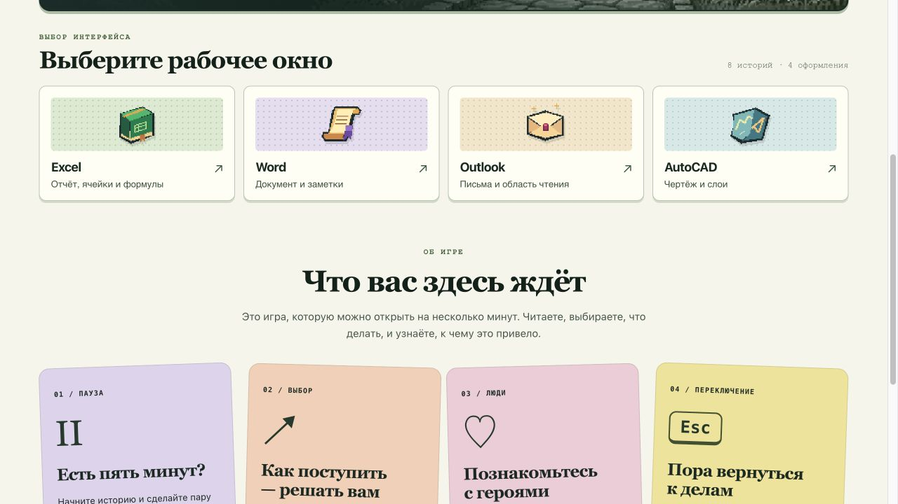

<div align="center">
  
  <h1>TabEscape</h1>
  <p><strong>Короткое приключение в привычном рабочем окне</strong></p>
  <p><a href="https://github.com/ruslan-berkin/project4zimran/actions/workflows/ci.yml"></a></p>
  <p>Браузерная текстовая RPG · 8 бесплатных историй · 4 офисных интерфейса · RU / EN</p>
  <p><a href="https://tabescape.onrender.com/">Открыть игру</a> · <a href="#установка-и-запуск">Запустить локально</a> · <a href="#как-проверить-решение">Проверить демо</a> · <a href="PITCH.md">Материал для питча</a> · <a href="docs/REVIEW.md">Проверка репозитория</a></p>
</div>



## О проекте

**TabEscape** — B2C-развлечение в браузере для короткого перерыва между рабочими задачами. Целевая аудитория проекта — офисные сотрудники 25–45 лет в США. Продукт отвечает на ситуацию: «У меня несколько свободных минут; хочу сделать пару ходов и быстро вернуться к документу».

Игрок выбирает офисное оформление, историю и действия героя. Нажатие **Esc** открывает подготовленный рабочий экран, повторное нажатие возвращает в ту же сцену. Русский и английский интерфейсы позволяют показать демо разной аудитории. Для бесплатного сценария не нужны регистрация, свой файл или ключ ИИ.

Проект подготовлен как демонстрация для хакатона в треке **Entertainment**. Проверенных данных о спросе, удержании или выручке пока нет; бизнес-допущения приведены ниже и в [PITCH.md](PITCH.md).

## Почему такой сценарий имеет смысл

Рабочая гипотеза: человеку с коротким свободным промежутком между задачами может быть интересна интерактивная история, к которой легко вернуться. Исследования ниже описывают ситуацию, **но не спрос на TabEscape и не готовность платить**. Источники проверены 15 ноября 2026 года.

| Наблюдение | Что именно измерено |
|---|---|
| **66%** | В опросе Software Finder 1 003 специалистов с полной занятостью в США сообщили, что оставались онлайн или поддерживали видимость активности после завершения задач. |
| **51%** | В том же опросе, **среди изображающих занятость**, сообщили о завершении реальной работы минимум за час до конца рабочего дня. Это не доля всех работников США. |
| **40%** | В опросе SurveyMonkey 3 573 работников с полной занятостью в США сообщили, что изображали занятость, занимаясь чем-то посторонним; вопрос не ограничен временем после выполнения задач. |

Первые два показателя: [Software Finder, The Productivity Performance Trap, 2026](https://softwarefinder.com/resources/faking-productivity-at-work). Третий: [SurveyMonkey, Workplace Culture and Trends, 2025](https://www.surveymonkey.com/curiosity/surveymonkey-research-workplace-culture-and-trends/); опрос 25 июля — 3 августа, невероятностная онлайн-панель, демографическое взвешивание. Это самоотчёты, а не наблюдение за поведением. Мы не переносим эти доли на весь мир и не выдаём их за размер платящей аудитории. Утверждения о пользе игры для продуктивности или превосходстве над соцсетями пока не проверены.

Офисное оформление меняет вид страницы, но не скрывает посещённый сайт от систем мониторинга. В [опросе Pew Research Center 2024 года, стр. 22](https://www.pewresearch.org/wp-content/uploads/sites/20/2024/12/PST_2024.12.10_americans-jobs_report.pdf#page=23) 35% наёмных работников, использующих рабочий компьютер, сообщали о мониторинге его использования. TabEscape не обещает техническую невидимость.

## Подписка и экономика: гипотеза для проверки

**Предлагаем тестировать Plus за $5.99 в месяц**: новые ИИ-сюжеты по жанрам, развитие отношений с персонажами и приключение без сюжетного лимита до гибели героя. Восемь авторских историй остаются бесплатными. Это предложение для будущего продукта: сейчас оплаты, проверки подписки и лимитов генерации нет, демо открыто.

Расчёт в USD, без налогов, скидок и годовых планов. Предположения, а не фактические метрики:

- 300 генераций на подписчика в месяц, включая вступления; в среднем 8 000 входных и 2 000 выходных токенов на запрос (включая reasoning). Бесконечность сюжета не означает безлимитные вычисления: перед продажами нужно проверить реальное потребление и определить прозрачный бюджет использования.
- [Groq GPT OSS 20B](https://console.groq.com/docs/model/openai/gpt-oss-20b): $0.075 за 1 млн входных и $0.30 за 1 млн выходных токенов на дату проверки. Базовая стоимость `300 × (8000 × 0.075 + 2000 × 0.30) / 1 000 000 = $0.36`. С резервом 20% на повторы — $0.432; в бюджете округляем до **$0.45**. Это модель затрат, не замер реальных партий.
- Платёжные комиссии: бюджет **$0.54** (допущение 4% + $0.30, не тариф выбранного провайдера); резерв переменной поддержки — **$0.50**. Всего **$1.49 на подписчика**, вклад до фиксированных расходов — **$4.50**.

| Платящих пользователей | Выручка в месяц | Переменные расходы | Хостинг и инструменты¹ | Остаток² |
|---:|---:|---:|---:|---:|
| 100 | $599 | $149 | $100 | $350 |
| 1 000 | $5 990 | $1 490 | $500 | $4 000 |
| 10 000 | $59 900 | $14 900 | $2 000 | $43 000 |

¹ Условный бюджет инфраструктуры для всей аудитории, включая бесплатных игроков; нужна нагрузочная проверка. ² **Не чистая прибыль:** ещё не учтены зарплаты, разработка и редактура кампаний, привлечение пользователей, налоги, возвраты и юридические расходы. При 3 000 генераций на подписчика только API с тем же резервом будет стоить $4.32; обещать неограниченное использование по этой цене рано.

Пример проверки LTV/CAC: при условном оттоке **8% в месяц** и вкладе **$4.50** упрощённый LTV = `$4.50 / 0.08 = $56.25`. При CAC **$20** отношение ≈ **2.8**, окупаемость привлечения ≈ **4.4 месяца**, до фиксированных расходов. Ни отток, ни CAC пока не измерены. Ориентир $100 млн ARR при $5.99/мес потребовал бы примерно **1.39 млн одновременно платящих подписчиков** — это масштаб амбиции, не прогноз или доказанный рынок.

Первая проверка спроса: 20 интервью с офисными сотрудниками США 25–45 лет и пилот на 100 добровольцах. Измерять понимание первого экрана, завершение первой истории, возврат через неделю, интерес к предложению $5.99 и фактическую оплату после подключения платежей. Перед покупкой трафика проверить стоимость генерации и удержание; пока достаточно интервью и добровольных рекомендаций. Сбор этих метрик в текущем демо ещё не реализован.

## Что реализовано

### Четыре оформления одной игры

| Интерфейс | Игровое представление | Рабочий экран по Esc |
|---|---|---|
| **Excel** | Сетка со сценой, вариантами хода и показателями | Заполненный Q4-отчёт либо книга пользователя: ячейки, формулы, листы, форматирование, экспорт `.xlsx` |
| **Word** | Страница документа с боковыми показателями | Редактируемый документ с лентой и базовым форматированием; скачивание HTML |
| **Outlook — в разработке** | Папки, список и область чтения сюжета | Демонстрационные письма, которые можно выбрать и прочитать |
| **AutoCAD — в разработке** | Чертёжная область и блоки приключения | Локальный браузерный план с масштабом и переключением слоя мебели |

Сейчас для игры открыты **Excel и Word**. Карточки Outlook и AutoCAD показывают окно «В разработке» с Мирой; описанные выше прототипы сохранены в коде, но недоступны через выбор интерфейса.

После выбора **любой** маски открывается подготовка партии: новая игра или продолжение, история, режим и обучение. Игра начинается только после подтверждения. При новом открытии сайта кнопка запуска по умолчанию выбирает Excel.

### Библиотека и механика

| Бесплатная история | Жанр |
|---|---|
| Оукхейвен: тихий колокол | Сдержанное фэнтези |
| Строка 17 | Детектив |
| Смотритель последнего маяка | Мистика |
| Шестая палата | Хоррор |
| Орбита без связи | Научная фантастика |
| Перевал до снегопада | Экспедиция |
| Письмо через осаду | Историческое приключение в вымышленном мире |
| Последний поезд | Триллер |

В каждой истории есть развилки, сбор сведений, предмет и разные финалы. Обычный путь занимает шесть выборов; использование предмета и собственное действие тоже считаются ходом. Рискованные действия могут завершить приключение раньше. Полный финал требует минимум трёх проверенных сведений и одного поступка, укрепляющего доверие. У каждой истории есть отдельное послесловие поражения: что стало с людьми после потери героя.

Реализованы три варианта действия, собственный ход, здоровье, бодрость, неприятности, инвентарь, журнал, график здоровья, рекорд, повторная игра и скачивание дневника. Ход добавляет 30 игровых минут. Новые кампании завершаются по сюжету или состоянию героя, а не автоматически в 18:00.

Проводница Мира объясняет интерфейс, позволяет сделать настоящий ход и попробовать переключение. Обучение можно пропустить и повторить. Верхняя панель сворачивается; для мыши и сенсорного экрана есть кнопка переключения.

### Темп и погружение

- На старте четыре карточки объясняют сценарий без чтения README; обучение предлагается в окне подготовки партии.
- Вступления восьми историй знакомят с миром через бытовую сцену и персонажа; личные обещания возвращаются в развязке. Тексты доступны на RU/EN.
- При отправке хода текущий текст остаётся видимым минимум 1.2 секунды. Новая сцена быстро печатается за 0.7–2.6 секунды без скачков высоты; до окончания печати (минимум 1.4 секунды) повторный выбор защищён. Esc доступен во время ожидания, а предпочтение reduced motion отключает анимацию.
- Для ИИ задано более подробное вступление, последствия решений, повторяющиеся персонажи и память отношений. Выполнение этих литературных требований моделью требует проверки реальных ответов.

### Premium и бесконечный режим

- **Без ключа:** Premium показывает готовую историю выбранного жанра с подписью «демо без ИИ». Бесконечный режим повторяет локальные главы до гибели героя — это не генерация новых сюжетов.
- **При включённом Groq, Gemini или OpenAI:** сервер запрашивает новые сцены и действия, передаёт модели память событий, последние ходы, показатели и инвентарь. Для Premium задан ориентир завершённой арки на 25–30 ходов (успешный финал не раньше 25-го); в бесконечном режиме окончание от модели игнорируется, пока герой жив.
- После первой завершённой **бесплатной** партии за день появляется предложение Premium с четырьмя преимуществами. Кнопка «Открыть Premium бесплатно» отмечает демо-доступ в этом браузере и открывает выбор жанра с Premium; бесконечный режим находится рядом. Прямо в окне указано: демо для жюри, без оплаты, карты и срока действия. Можно продолжить бесплатные истории или закрыть окно и дочитать финал. Все режимы доступны и без активации; платной подписки и проверки оплаты нет. После активации предложение автоматически не повторяется. Золотистая кнопка Premium с короной на главной позволяет открыть его вручную в любой момент. Демо-доступ не снимает лимиты Groq/OpenAI. Вручную открыв это окно, можно нажать «Сбросить демо для проверки»: очищаются только отметка Premium и счётчик завершений, рекорд и настройки остаются.

Для ИИ-режимов с 10-го хода каждые пять ходов растёт нагрузка: дополнительные затраты бодрости 2/4/6/8/10 и неприятности +1/+2/+3/+4/+5. Модель получает стадию сложности и должна заранее объяснять риск, предлагать восстановление и учитывать отношения. К 25–30-му ходу выжить без отдыха заметно труднее; обязательной смерти на заданном ходу нет. Это начальный баланс, а не измеренная статистика выживания игроков.

### Резервные ключи API

В серверном `.env` оставьте основной `GROQ_API_KEY` и при необходимости добавьте `GROQ_API_KEYS=резервный_ключ_1,резервный_ключ_2`. Для OpenAI предусмотрен аналогичный `OPENAI_API_KEYS`. После изменения перезапустите сервер. Ключи нельзя добавлять в Git или браузерный код.

При HTTP 429/401/403/5xx сервер пробует следующий доступный ключ того же провайдера: максимум три попытки за запрос, с паузой для ключа по `Retry-After`. Паузы хранятся в памяти каждого процесса; для большого развёртывания потребуется общая очередь. При таймауте автоматического повтора нет, поскольку первый запрос мог быть обработан и оплачен. Неуспешный ход не применяется; игрок видит подсказку о времени повтора. Контекст сокращён до четырёх последних событий и компактной памяти отношений.

**Несколько ключей одной организации не увеличивают её квоту** — [Groq применяет общие лимиты организации](https://console.groq.com/docs/rate-limits). Резерв помогает при доступной квоте резервного ключа или его собственном сбое; для общей квоты нужен подходящий тариф/лимит. Переключения на другой сервис без настройки нет. Чтобы включить **Gemini как резерв Groq**, задайте:

```dotenv
AI_PROVIDER=groq
AI_ENABLED=true
GROQ_API_KEY=основной_ключ_Groq
GEMINI_API_KEY=ключ_Gemini
GEMINI_MODEL=gemini-3.5-flash-lite
AI_FALLBACK_PROVIDERS=gemini
```

Gemini можно выбрать и основным: `AI_PROVIDER=gemini`. Дополнительные ключи Gemini: `GEMINI_API_KEYS`. Интеграция использует [generateContent и JSON Schema](https://ai.google.dev/api/generate-content), без нового SDK. После HTTP 401/403/429/5xx Groq разрешённый резерв получает ту же сцену, память, действие и показатели. Только валидный ответ меняет движок партии; при общей ошибке ход не применяется. Допускается один резервный провайдер, до трёх ключей за попытку каждого сервиса. Без `AI_FALLBACK_PROVIDERS` перехода между сервисами нет. Ключи сокомандника используют его квоту и биллинг; лимиты проекта/организации по-прежнему действуют. Выберите модель, доступную именно вашему аккаунту. 15 ноября 2026 проверен реальный Gemini с ключом команды: при искусственном HTTP 429 Groq он продолжил текущую историю и обработал следующий ход. Лимит имитировался только в отдельном проверочном процессе; генерация Gemini была реальной. Транспорт и сохранность контекста также покрыты автоматическими тестами.

## Как работает решение

1. Игрок открывает сайт и выбирает язык и офисный интерфейс.
2. В окне подготовки выбирает историю, режим и необходимость обучения. Для Excel можно дополнительно открыть свою рабочую книгу; это необязательно.
3. Кнопка запуска вызывает `/api/start`. Сервер возвращает сцену, показатели, три действия и подписанное состояние партии.
4. Выбранное или введённое действие отправляется в `/api/action`. Сервер рассчитывает последствия встроенным движком либо запрашивает выбранного ИИ-провайдера для включённых ИИ-режимов.
5. Браузер показывает новую сцену, время, показатели и запись журнала.
6. Esc или экранная кнопка переключает представление без перезагрузки и без нового игрового API-запроса. Повторное переключение возвращает ту же партию.

При смене маски можно продолжить текущую историю. Правки рабочего экрана сохраняются в пределах текущей вкладки. Ответ хода, пришедший во время работы с документом, показывается после возвращения к игре.

## Технологии

| Компонент | Используется в репозитории |
|---|---|
| Сервер | Python, Flask, Gunicorn |
| Клиент | HTML, CSS, обычный JavaScript без фронтенд-фреймворка |
| HTTP и конфигурация | `requests`, `python-dotenv` |
| Проверка состояния | Подпись через `itsdangerous`, поставляемый с Flask |
| Истории | Локальный JSON с русскими и английскими текстами |
| Excel | Клиентский разбор и вычисление поддерживаемых формул; серверная работа с OOXML через `zipfile` и `xml.etree.ElementTree` |
| ИИ | Groq Chat Completions (`openai/gpt-oss-20b`) , Gemini generateContent (`gemini-3.5-flash-lite`) или OpenAI Responses (`gpt-5-mini`); JSON Schema / Structured Outputs |
| Проверки | Python `unittest`, имитация ответов ИИ, проверка синтаксиса JavaScript, `pip-audit` |
| Развёртывание | `Procfile` и конфигурация Render в `render.yaml` |

В коде также сохранён прежний путь Groq/Gemini для совместимости старого API. Новые кампании используют встроенный движок, Groq, Gemini или OpenAI в зависимости от серверной конфигурации. База данных, аккаунты и платёжный сервис отсутствуют.

## Архитектура проекта


```text
.
├── README.md                  # Обзор для жюри и быстрый запуск
├── PITCH.md                   # Сценарий питча и бизнес-гипотезы
├── .env.example               # Шаблон серверных настроек без ключей
├── render.yaml                # Конфигурация хостинга
├── .github/                   # CI, шаблоны issues и pull requests
├── docs/                      # Итоги ревью, происхождение ресурсов, скриншот
├── TabEscape (2).html          # Самостоятельный исторический референс
└── tabescape_app/
    ├── app.py                 # API, движки, экспорт XLSX, резервные ресурсы
    ├── templates/index.html   # Обслуживаемая страница Flask
    ├── static/
    │   ├── js/                # Игра, маски, обучение, локализация
    │   ├── css/               # Оформление и адаптивная компоновка
    │   ├── data/              # Кампании и демонстрационная книга
    │   └── images/            # Локальные изображения интерфейса
    ├── scripts/embed_assets.py
    ├── tests/                 # Проверки API, историй и восстановления
    ├── requirements.txt
    └── Procfile
```

Канонические файлы интерфейса — `templates/` и `static/`. `_EMBEDDED_FILES` в `app.py` содержит резервную копию для восстановления отсутствующих ресурсов. После изменения интерфейса её нужно обновлять скриптом. Корневой `TabEscape (2).html` не является точкой запуска Flask.

## Установка и запуск

Нужны Git и Python 3.11 или 3.12. Команды ниже рассчитаны на macOS/Linux.

```sh
git clone https://github.com/ruslan-berkin/project4zimran.git
cd project4zimran/tabescape_app
python3 -m venv .venv
source .venv/bin/activate
pip install -r requirements.txt
```

При первом запуске создайте конфигурацию:

```sh
cp .env.example .env
python app.py
```

Откройте **[http://localhost:5050](http://localhost:5050)**. Шаблон `.env` задаёт порт 5050; без файла используется 5000. Если порт занят:

```sh
PORT=5051 python app.py
```

Для бесплатной библиотеки оставьте `AI_ENABLED=false`.

### Подключение Groq, Gemini или OpenAI

В **`tabescape_app/.env`**, а не в HTML или JavaScript, задайте:

```dotenv
AI_PROVIDER=groq
AI_ENABLED=true
GROQ_API_KEY=ваш_ключ_Groq
GROQ_MODEL=openai/gpt-oss-20b
TABESCAPE_SECRET_KEY=постоянный_случайный_секрет
PORT=5050
```

Ключ создаётся в [Groq Console](https://console.groq.com/keys). Модель `openai/gpt-oss-20b` обслуживается **Groq**: для неё нужен ключ Groq, а баланс OpenAI не используется. Интеграция использует [Chat Completions](https://console.groq.com/docs/api-reference) и [строгий JSON Schema](https://console.groq.com/docs/structured-outputs). При смене `GROQ_MODEL` выбирайте модель с поддержкой strict Structured Outputs.

Для OpenAI вместо этого задайте `AI_PROVIDER=openai`, `AI_ENABLED=true`, `OPENAI_API_KEY` и `OPENAI_MODEL=gpt-5-mini`. `AI_ENABLED` имеет приоритет над прежним `OPENAI_ENABLED`; старые конфигурации без `AI_ENABLED` продолжают работать. Резервный провайдер включается явно через `AI_FALLBACK_PROVIDERS` (см. выше). После смены провайдера начните новую партию.

Секрет подписи создаётся один раз:

```sh
python -c 'import secrets; print(secrets.token_hex(32))'
```

Перезапустите сервер, обновите страницу и начните новую игру в Premium или бесконечном режиме. Ключ остаётся на сервере; `.env` исключён из Git. Бесплатные истории не вызывают ИИ API даже при подключённом ключе. Автоматические тесты используют имитации ответов. 15 ноября 2026 после замены ключа проверены реальные вступления и по пять последовательных ходов в Premium и бесконечном режиме через Groq (`engine=groq`). Наблюдались лимит `429` и отдельные ошибки генерации; повтор хода с прежним состоянием успешно продолжил партию. Стабильность под нагрузкой пока не подтверждена. Лимиты зависят от аккаунта и модели — [документация Groq](https://console.groq.com/docs/rate-limits). Приложение различает ошибки доступа и лимитов, не раскрывая ответ провайдера или ключ. Полное прохождение с ИИ до финала или гибели в этом прогоне не проверялось; литературное качество ответов ещё требует редакционной оценки.

### Запуск через Gunicorn

Из `tabescape_app`:

```sh
gunicorn app:app --timeout 60 --bind 0.0.0.0:8000
```

Для нескольких процессов задайте одинаковый `TABESCAPE_SECRET_KEY`; иначе подписанное состояние разных процессов будет несовместимо. Проверка доступности сервера: `GET /healthz`.

## Как проверить решение

Сценарий для жюри без аккаунта, собственного файла и ключа:

1. Откройте сайт, при необходимости переключите язык на русский.
2. Выберите **Excel**. Убедитесь, что сначала открылось окно подготовки.
3. Выберите **Бесплатно → Оукхейвен: тихий колокол**, включите обучение и начните игру.
4. Сделайте один из предложенных ходов. Время изменится с **09:00 на 09:30**; выбор отразится в сцене, показателях и журнале.
5. На шаге переключения нажмите **Esc**: откроется заполненный Q4-отчёт. Повторный Esc вернёт ту же сцену. В начале обучения Esc пропускает подсказки; переключение также доступно экранной кнопкой.
6. В рабочем Excel выберите B2, измените `125000` на `130000` в строке формул и нажмите Enter. Значение D2 изменится с `15000` на `10000`. Выгрузите `.xlsx`.
7. Через **Маски** выберите **Word → Продолжить**. История, время и журнал сохранятся. Нажмите Esc, отредактируйте рабочий документ и переключитесь туда и обратно: правка останется.
8. Попробуйте другую бесплатную историю или Premium / бесконечный режим. Без ключа последние два явно обозначены как демо.

В настройках Esc закрывает диалог; во время ввода формулы отменяет редактирование. Для узкого экрана используйте кнопку переключения.

### Автоматические проверки

Из `tabescape_app`:

```sh
python -m unittest discover -s tests -v
gunicorn app:app --check-config --timeout 60
```

После изменения ресурсов:

```sh
python scripts/embed_assets.py
```

Тесты проверяют финалы всех восьми историй на двух языках, показатели, инвентарь, бесконечный режим, обработку ошибок ИИ, экспорт книги, резервное восстановление и ошибочные запросы. Подробности и границы проверок — в [отчёте ревью](docs/REVIEW.md) и [журнале браузерных проверок](tabescape_app/VERIFICATION.md).

## Данные и интеграции

- `static/data/campaigns.json` — восемь встроенных историй RU/EN. `story-en.json` относится к прежнему движку.
- `static/data/Книга1.xlsx` — демонстрационный отчёт. При ошибке чтения доступен встроенный прогноз; книга пользователя имеет приоритет.
- Документ Word, письма Outlook и чертёж AutoCAD — локальные демонстрационные данные, без подключения к рабочим аккаунтам.
- Выбранный провайдер (Groq, Gemini или OpenAI) получает контекст истории только при включённой генерации. Для OpenAI используется `store:false`. Параметры и интеграция описаны в [техническом README](tabescape_app/README.md#premium-и-ии).
- При экспорте Excel браузер передаёт Flask-серверу книгу и правки. Лимит тела API-запроса — 16 МиБ, включая JSON и кодирование файла.
- Происхождение изображений и статус прав описаны в [ASSETS.md](docs/ASSETS.md).

## Ограничения текущей версии

- Партия, журнал и рабочие правки сохраняются **только до перезагрузки текущей вкладки**. Язык, обучение, скрытие панели и рекорд сохраняются в браузере. Загрузки сохранённой партии нет.
- Нет аккаунтов, оплаты, серверной проверки подписки и ограничения расходов на ИИ для коммерческого доступа. Предложение после первой бесплатной истории не блокирует демо.
- Без подключённого ИИ бесконечный режим повторяет локальные главы. Качество длинных ИИ-партий требует игровой проверки; переключение на Gemini проверено с реальной генерацией и искусственным 429, но стабильность под нагрузкой ещё не измерялась.
- Это офисные маски, а не полные аналоги Microsoft Office или AutoCAD. DWG не импортируется; Word экспортирует HTML, а не DOCX.
- Excel принимает `.xlsx`, `.csv`, `.tsv`, `.txt`; бинарный `.xls` не поддерживается. Доступно подмножество формул; неподдерживаемые импортированные формулы могут показывать кэш Excel.
- Интерфейс, новые истории, действия и подсказки переведены на RU/EN; рабочие демонстрационные материалы преимущественно английские.
- Архитектура сохраняет монолитные `app.py` и `app.js` и прежний движок совместимости. Дальнейшее разделение модулей — отдельная задача.
- Лицензия проекта не выбрана, права на распространение предоставленного командой оформления требуют подтверждения. Это не заявление об аффилированности с производителями офисных приложений.

## Публичная версия и материалы для подачи

**Игра онлайн: [tabescape.onrender.com](https://tabescape.onrender.com/)** — без входа и регистрации. Опубликована на Render 15 ноября 2026 года. Проверены бесплатная история, реальная генерация Premium и бесконечного режима через Groq, ход и возврат через Esc в Excel и Word. Gemini настроен как резерв; искусственный отказ Groq на публичном сервере не провоцировался.

### Развёртывание на Render

1. В [Render Dashboard](https://dashboard.render.com/) выберите **New → Blueprint** и репозиторий `ruslan-berkin/project4zimran`, ветку `main`.
2. Используйте корневой `render.yaml`. Он задаёт бесплатный Web Service, Python 3.12, каталог `tabescape_app`, установку зависимостей и Gunicorn. Один процесс с четырьмя потоками позволяет проверке здоровья отвечать, пока генерируется история; тайм-аут 120 секунд оставляет время на резервный запрос.
3. Введите `GROQ_API_KEY` и `GEMINI_API_KEY` в защищённые поля Render. Эти значения не попадают в GitHub; локальный `.env` не переносится на сервер. `TABESCAPE_SECRET_KEY` Render создаст автоматически — сохраните его при следующих развёртываниях.
4. Дождитесь статуса **Live**, откройте выданную ссылку `https://…onrender.com` и проверьте `/healthz`, бесплатную историю, Premium и переключение по Esc. Без ключей бесплатные истории работают, а ИИ-режимы используют локальное демо.

Для существующего сервиса новые ключи добавляются вручную в **Environment**: `sync: false` запрашивает секреты только при первом создании Blueprint. Настройки ИИ: `AI_ENABLED=true`, `AI_PROVIDER=groq`, `GROQ_MODEL=openai/gpt-oss-20b`, `AI_FALLBACK_PROVIDERS=gemini`, `GEMINI_MODEL=gemini-3.5-flash-lite`.

Бесплатный сервер [засыпает после 15 минут без запросов](https://render.com/docs/free); следующее открытие занимает около минуты. Перед показом жюри откройте ссылку заранее. Публичная ИИ-генерация расходует квоту серверных ключей; коммерческого ограничения расходов в этой версии нет.

- [Публичный GitHub](https://github.com/ruslan-berkin/project4zimran) — исходный код и инструкции.
- [PITCH.md](PITCH.md) — материал для пяти минут питча и демонстрации, с явно обозначенными бизнес-гипотезами.
- Публичная рабочая ссылка готова; PDF-презентацию до 10 слайдов ещё нужно подготовить.

Для дальнейших изменений см. [CONTRIBUTING.md](CONTRIBUTING.md).
