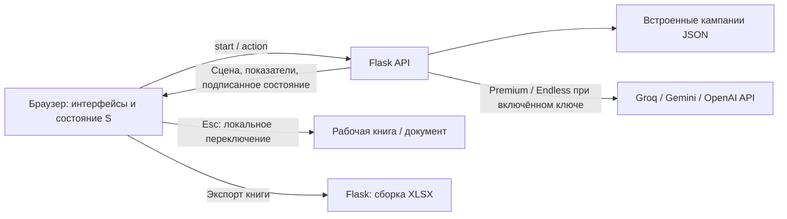

<div align="center">
  
  <h1>TabEscape</h1>
  <p><strong>Короткое приключение в привычном рабочем окне</strong></p>
  <p><a href="https://github.com/ruslan-berkin/project4zimran/actions/workflows/ci.yml"></a></p>
  <p>Браузерная текстовая RPG · 8 бесплатных историй · Excel и Word · RU / EN</p>
  <p><a href="https://tabescape.onrender.com/">Открыть игру</a> · <a href="#установка-и-запуск">Запустить локально</a> · <a href="#как-проверить-решение">Проверить демо</a> · <a href="docs/presentation/TabEscape-Pitch-Deck.pdf">Презентация PDF</a> · <a href="PITCH.md">Сценарий питча</a> · <a href="docs/REVIEW.md">Проверка репозитория</a></p>
</div>


## О проекте

**TabEscape** — B2C-развлечение в браузере для свободного времени в течение рабочего дня. Целевая аудитория проекта — офисные сотрудники 25–45 лет в США.

Игра рассчитана на две знакомые ситуации:

- **Короткий перерыв между задачами.** Есть несколько свободных минут: можно прочитать сцену, сделать один-два хода и вернуться к работе.
- **Задачи уже выполнены, а рабочий день ещё не закончился.** Например, сотрудник закончил всё запланированное к 16:30, но по графику должен оставаться в офисе до 18:00. Пока новых задач нет, можно продолжить приключение и отвлечься, когда снова понадобишься коллегам.

Сценарий словами пользователя: «Я уже закончил свои задачи, но до конца рабочего дня ещё есть время. Хочется заняться чем-то интересным, что легко прервать».

Игрок выбирает офисное оформление, историю и действия героя. Нажатие **Esc** открывает подготовленный рабочий экран, повторное нажатие возвращает в ту же сцену. Русский и английский интерфейсы позволяют показать демо разной аудитории. Для бесплатного сценария не нужны регистрация, свой файл или ключ ИИ.

Проект подготовлен как демонстрация для хакатона в треке **Entertainment**. Проверенных данных о спросе, удержании или выручке пока нет; бизнес-допущения приведены ниже и в [PITCH.md](PITCH.md).

## Почему такой сценарий имеет смысл

Рабочая гипотеза: человеку со свободным временем между задачами или после их завершения, пока рабочий день по графику ещё продолжается, может быть интересна интерактивная история, которую легко прервать и продолжить позже в том же браузере. Исследования ниже описывают ситуацию, **но не спрос на TabEscape и не готовность платить**. Источники проверены 15 ноября 2026 года.

| Наблюдение | Что именно измерено |
|---|---|
| **66%** | В опросе Software Finder 1 003 специалистов с полной занятостью в США сообщили, что оставались онлайн или поддерживали видимость активности после завершения задач. |
| **51%** | В том же опросе, **среди изображающих занятость**, сообщили о завершении реальной работы минимум за час до конца рабочего дня. Это не доля всех работников США. |
| **40%** | В опросе SurveyMonkey 3 573 работников с полной занятостью в США сообщили, что изображали занятость, занимаясь чем-то посторонним; вопрос не ограничен временем после выполнения задач. |

Первые два показателя: [Software Finder, The Productivity Performance Trap, 2026](https://softwarefinder.com/resources/faking-productivity-at-work). Третий: [SurveyMonkey, Workplace Culture and Trends, 2025](https://www.surveymonkey.com/curiosity/surveymonkey-research-workplace-culture-and-trends/); опрос 25 июля — 3 августа, невероятностная онлайн-панель, демографическое взвешивание. Это самоотчёты, а не наблюдение за поведением. Мы не переносим эти доли на весь мир и не выдаём их за размер платящей аудитории. Утверждения о пользе игры для продуктивности или превосходстве над соцсетями пока не проверены.

Офисное оформление меняет вид страницы, но не скрывает посещённый сайт от систем мониторинга. В [опросе Pew Research Center 2024 года, стр. 22](https://www.pewresearch.org/wp-content/uploads/sites/20/2024/12/PST_2024.12.10_americans-jobs_report.pdf#page=23) 35% наёмных работников, использующих рабочий компьютер, сообщали о мониторинге его использования. TabEscape не обещает техническую невидимость.

## Кому мы продаём и за что человек платит

**TabEscape — сюжетная игра на несколько свободных минут между рабочими задачами.** Игрок читает сцену, принимает решение и возвращается к делам; история ждёт его следующего перерыва. Покупатель — сам игрок, а не его работодатель. Мы продаём развлечение, а не повышение продуктивности или обход контроля компьютера.

**Первый сегмент — гипотеза:** офисные сотрудники 25–45 лет в США, которым нравятся детективы, интерактивные истории или RPG и у которых несколько раз в неделю возникают короткие свободные промежутки. Для первого набора ищем людей из административных, финансовых и операционных ролей, работающих за компьютером. Название должности само по себе не означает наличие свободного времени или интереса к игре: это проверяем при наборе.

| Вопрос | Наш выбор для первого теста |
|---|---|
| Когда играют? | Между задачами или когда запланированное сделано, но рабочий день по графику продолжается. Первый тест — перерывы примерно по 3–10 минут, а не обещание закончить любую историю за это время. |
| Что хочется получить? | «Хочу отвлечься на небольшую историю, которую можно прервать без потери прогресса». Это формулировка команды, пока не цитата из интервью. |
| Чем обходятся сейчас? | Предполагаемые альтернативы: соцсети, короткие видео, казуальные игры и чтение. Узнаем реальное поведение, не будем заранее объявлять нашу игру лучше. |
| Почему попробовать TabEscape? | Решения меняют историю; можно вернуться к персонажам и продолжить сохранённую партию. Excel/Word — узнаваемое оформление и быстрый переход к рабочему экрану. |
| За что платить? | За новые ИИ-приключения, выбор жанра и продолжение без заранее заданного сюжетного финала. Бесплатные восемь историй позволяют сначала проверить, нравится ли такой досуг. |
| Кого пока не берём за основу рынка? | Всех работников мира, корпоративных закупщиков и людей, которым не нравятся текстовые игры. Для них у нас нет подтверждённого предложения. |

Офисная маска может привлечь внимание, но **гипотеза удержания — интерес к истории и последствиям решений**. Если люди приходят ради необычного вида и не возвращаются, одного оформления для подписного бизнеса недостаточно.

## Что известно, а что ещё проверяем

| Статус | Что можно утверждать |
|---|---|
| Реализовано и технически проверено | Бесплатный сценарий без регистрации, восемь историй, Excel/Word, Esc, сохранение партии в этом браузере, серверная ИИ-генерация при доступном провайдере. Это возможности продукта, не доказательство спроса. |
| Есть внешний контекст | Опросы выше описывают свободное время и видимость занятости. Они не измеряют желание играть в TabEscape, удержание или готовность покупать. |
| Гипотеза команды | Выбранный сегмент захочет возвращаться к историям и платить $6.99/месяц за Premium. |
| Пока нет данных | Интервью с целевыми покупателями, измеренных когорт D7/D30, настоящих оплат и продлений, фактических CAC и LTV. Посещения и API-запросы, в том числе проверки жюри и агентов, не заменяют эти данные. |

## Как проверим спрос и готовность платить

Это **план будущего исследования**, а не отчёт о проведённых интервью или продажах. Числа ниже — заранее выбранные командой пороги для следующего решения, не отраслевые нормы и не статистическое доказательство. Сроки отсчитываются от начала набора. Расходы — предлагаемый бюджет; деньги ещё не потрачены.

### 1. Проверить ситуацию: 20 интервью, первая неделя

Набираем работающих в США людей 25–45 лет из выбранного сегмента, а не только знакомых и участников хакатона. Включаем тех, кто играет редко или не платит за игры, чтобы услышать причины отказа. Каналы: сообщества интерактивной прозы/RPG с работающей аудиторией и профессиональные сообщества выбранных ролей, с разрешения модераторов. Отдельно фиксируем источник каждого участника: такая выборка не представляет всех офисных сотрудников.

До показа продукта спрашиваем:

1. «Когда за последнюю неделю у вас было свободное время между задачами? Сколько оно длилось?»
2. «Что вы делали в этот момент? Почему выбрали именно это?»
3. «Что мешает так отдыхать или быстро вернуться к работе?»
4. «За какое развлечение вы платили за последние три месяца и почему?»
5. После короткой самостоятельной игры: «Что было интересно, что раздражало и в какой ситуации вы открыли бы это снова?»

Не начинаем с вопроса «Купили бы вы нашу игру?». **Первый ориентир:** минимум 12 из 20 могут описать конкретный недавний эпизод, а минимум 8 из этих 12 уже выбирали развлечение в такие моменты. Если эпизодов мало, пересматриваем сегмент и ситуацию, а не выдаём вежливый интерес за подтверждение проблемы. Ответы сохраняем обезличенно, с согласия участников; реальные цитаты добавим только после интервью.

### 2. Проверить игру и возвращение: 100 участников, недели 2–3

Набираем 100 новых подходящих участников; интервьюируемых учитываем отдельно. Даём обычную английскую ссылку и просим начать самостоятельно. Не напоминаем о возвращении в первые семь дней: сначала измеряем, хочется ли продолжить без подсказки команды. Если позже тестируем напоминания, это отдельная группа. Демо остаётся бесплатным.

| Проверка | Как считаем | Порог для следующего теста — гипотеза |
|---|---|---|
| Понятна ли главная? | 10 отдельных проверок: после краткого просмотра человек своими словами объясняет, что здесь делают и когда играют | Не менее 8 из 10; это качественный тест, не оценка конверсии |
| Начинают ли играть? | Уникальные участники с первым успешно применённым ходом / 100 участников, открывших ссылку | Не менее 60 из 100 |
| Доходят ли до финала? | Уникальные участники с концовкой бесплатной истории за 7 дней / те же 100 | Не менее 30 из 100; победа и поражение считаются финалами |
| Возвращаются ли? | D7: участники с новым успешным ходом в интервале 168–192 часа после первого хода / активированные участники, для которых этот интервал уже закончился | Не менее 20%; при 60 активированных — хотя бы 12 вернувшихся |
| Интересно ли платное предложение? | Уникальные нажавшие на явно обозначенное предложение $6.99/месяц / уникальные увидевшие это предложение | Не менее 6 из первых 30 увидевших; это намерение, не покупка |

Намерение проверяем **отдельно от кнопки бесплатного доступа для жюри**: в исследовательском варианте честно пишем «Хочу оформить за $6.99/месяц — продажи ещё не открыты», без сбора карты и без списания. Такой вариант ещё предстоит реализовать. Нажатие «Открыть Premium бесплатно» в текущем демо никогда не считаем готовностью платить. Если участников меньше порога, результат — «данных недостаточно», а не автоматически успех или провал.

### 3. Проверить настоящую оплату: после подготовки биллинга

Подключаем оплату, отмену подписки, учёт доступа и понятные условия использования ИИ. Затем показываем **одно и то же предложение $6.99/месяц** новой группе из 100 целевых пользователей, увидевших платное предложение после бесплатной истории. Не оплачиваем им покупку и не включаем команду или жюри. Демо для жюри остаётся отдельным бесплатным режимом.

Первые **5 оплаченных и не возвращённых в течение 30 дней подписок из 100 показов** — наш ориентир для продолжения проверки, не доказанный масштабируемый спрос. Считаем отдельно показы, попытки оплаты, успешные первые списания, возвраты и продления. Если есть клики, но почти нет платежей, выясняем причину: цена, ценность, доверие или техническая ошибка оплаты. Проверка другой цены — отдельная последующая когорта, а не одновременная смена нескольких условий.

До масштабирования набираем хотя бы **50 настоящих плательщиков и наблюдаем три месячных цикла продления**. Даже эта выборка даёт лишь предварительную оценку оттока; 12-месячный LTV останется моделью, пока нет достаточно длинной истории платежей. Если платить не хотят, проверим разовую покупку кампаний как отдельную гипотезу, а не будем считать подписную модель подтверждённой.

### 4. Измерять так, чтобы не принять проверку сайта за спрос

Событийная продуктовая аналитика и платёжные события **пока не внедрены**. Перед пилотом нужно добавить: `landing_view`, `adventure_started`, `turn_completed`, `story_finished`, `adventure_resumed`, `premium_offer_viewed`, `premium_intent`, а после биллинга — `payment_succeeded`, `subscription_renewed`, `subscription_ended`, `refund`.

Первый ход и финал считаем по успешному ответу сервера, оплату — по проверенному платёжному уведомлению, не по нажатию кнопки. Нужны анонимный идентификатор участника, время UTC, источник/кампания, режим демо или платного теста, идентификаторы партии и события для удаления дублей. Не отправляем в аналитику тексты своих ходов, документы, API-ключи или содержимое историй.

Тестовый трафик команды, жюри и автоматизированных проверок учитываем отдельно от рекрутированной исследовательской когорты. Один User-Agent не позволяет надёжно определить человека. На бесплатном пути регистрация не нужна; до появления устойчивого идентификатора очистка браузера и смена устройства ограничивают точность уникальных пользователей. При платном тесте связываем покупки с клиентом платёжного провайдера с соблюдением выбранной политики данных. Для D30 используем новый успешный ход через 720–744 часа после первого. D7/D30 считаем только по когортам с полным сроком наблюдения, а не по всем посетителям за день.

## Подписка и экономика: гипотеза для проверки

**Предлагаем тестировать Premium за $6.99 в месяц.** В PDF команды подписка называется Plus; это то же предложение, не второй тариф. В окне сайта указаны планируемая цена и бесплатный доступ для жюри. Настоящие платежи, проверка платного доступа и коммерческие лимиты ещё не подключены. Новые ИИ-истории и жанры — предполагаемая причина покупки; «бесконечный» означает отсутствие заданного сюжетного финала, а не обещание неограниченных вычислений.

### Из чего складываются расходы

Все суммы ниже в USD. **Сценарная модель, не фактическая экономика:** цена $6.99, без скидок и налогов с продаж; расходы на возвраты и неоплаченные счета в базовый пример не включены и должны появиться после измерений.

| Допущение на платящего пользователя в месяц | Значение и расчёт |
|---|---|
| Использование ИИ | 300 генераций, включая вступления; в среднем 8 000 входных и 2 000 оплачиваемых выходных токенов, включая reasoning. Это ещё не измерено. |
| API Groq GPT OSS 20B | `300 × (8 000 × $0.075 + 2 000 × $0.30) / 1 000 000 = $0.36`; с резервом 20% — $0.432; бюджет округлён до **$0.45** |
| Платёжная комиссия | **$0.58**: округлённое допущение `4% × $6.99 + $0.30`, а не тариф выбранного платёжного сервиса |
| Переменная поддержка | **$0.50** — условный резерв; время команды пока не измерено |
| Всего переменных расходов | **$1.53** |
| Вклад подписчика до фиксированных расходов и привлечения | `$6.99 − $1.53 = $5.46/месяц`, около **78.1%** выручки |

Цены входных/выходных токенов проверены 15 ноября 2026 года в [официальной документации Groq](https://console.groq.com/docs/model/openai/gpt-oss-20b). Бесплатную квоту провайдера не считаем устойчивой себестоимостью бизнеса. Цена резервного Gemini, фактическая доля переключений, длина контекста и оплаченные неудачные попытки могут изменить бюджет: до продаж измеряем расход отдельно по каждому провайдеру, среднее и 95-й процентиль на игрока. Резерв 20% не доказывает, что все такие расходы покрыты.

### CAC: сколько стоит один новый покупатель

`CAC = расходы на привлечение когорты / новые платящие клиенты из этой когорты`.

В числитель включаем рекламу, размещения, подготовку материалов и время привлечения; в знаменатель — **новых настоящих плательщиков**, а не регистрации, визиты, бесплатные активации Premium или повторные списания. Для осторожной оценки ниже исключаем полностью возвращённые первые платежи и показываем отдельно стоимость привлечения до возвратов. Не смешиваем разные окна наблюдения и источники.

**Предлагаемый небольшой тест, пока не запущенный:** $300 на один рекламный канал с целевой аудиторией, $100 на отдельное размещение у небольшого автора о сюжетных играх, 5 часов команды по условным $20 = $100. Итого **$400 денежных расходов и $100 оценки труда = $500**. Размечаем источники отдельно; сравниваем CAC по каналу и общий CAC. Органические рекомендации тоже не объявляем бесплатными, если на них тратится время команды. Исследовательские интервью и продуктовую разработку учитываем отдельно, не прячем в CAC рекламного теста.

| Пример исхода одного теста — не прогноз | Новые плательщики после окна возвратов | CAC с трудом команды | CAC только по денежным расходам |
|---|---:|---:|---:|
| Слабый отклик | 10 | $50 | $40 |
| Базовое допущение | 25 | $20 | $16 |
| Сильный отклик | 50 | $10 | $8 |

Чтобы получить базовый пример, **допустим** 500 подходящих уникальных посетителей и 5% покупок: `500 × 5% = 25`, `$500 / 25 = $20`. Ни 500 посетителей за этот бюджет, ни 5% конверсии ещё не достигнуты. Здесь знаменатель конверсии — все посетители кампании; в тесте цены выше — только увидевшие предложение. Эти показатели нельзя подменять друг другом. При нуле покупателей CAC не равен нулю: стоимость привлечения покупателя не подтверждена.

### LTV: сколько остаётся от подписчика за всё время

Используем **LTV по вкладу**, а не суммарную выручку: `LTV ≈ месячный вклад / месячный отток платящих клиентов`. Отток за месяц — потерявшие платную подписку из числа платящих в начале месяца / платящие в начале месяца; новые подписчики не входят в этот знаменатель. Отмена будущего продления становится оттоком, когда закончился оплаченный доступ. Неуспешные продления и добровольные отмены фиксируем отдельно.

Формула предполагает постоянные цену, затраты и вероятность ухода, без дисконтирования, расширения чека и реактиваций. У нас этих наблюдений пока нет. В дальнейшем считаем накопленный вклад фактических платёжных когорт; не экстраполируем одну удачную неделю на годы.

| Сценарий чувствительности — все значения гипотетические | Месячный отток | CAC | LTV при вкладе $5.46 | LTV / CAC | Простая окупаемость CAC¹ |
|---|---:|---:|---:|---:|---:|
| Неблагоприятный | 15% | $50 | $36.40 | 0.73× | 9.16 месяца |
| Базовый | 8% | $20 | $68.25 | 3.41× | 3.66 месяца |
| Благоприятный | 4% | $10 | $136.50 | 13.65× | 1.83 месяца |

¹ `CAC / месячный вклад` — условный срок для продолжающего платить клиента, без учёта ухода. **В неблагоприятном сценарии средний клиент вообще не окупает привлечение:** его LTV ниже CAC, несмотря на формальные 9.16 месяца. Сценарии не имеют присвоенных вероятностей; нельзя считать благоприятный прогнозом.

В базовом сценарии `LTV = $5.46 / 0.08 = $68.25`. Более ограниченный **вклад за первые 12 месяцев после покупки с учётом оттока**: `$5.46 × (1 − 0.92^12) / 0.08 = $43.16` на исходного подписчика; вклад первого периода включён полностью. Оба результата расчётные, не заработанные деньги.

**Наш условный порог для увеличения рекламного бюджета:** LTV/CAC не ниже 3 и простая окупаемость не дольше 4 месяцев. При базовых допущениях потолок CAC — `min($68.25 / 3, $5.46 × 4) = $21.84`; рабочая цель — **не выше $20**. Это решение команды, не универсальная норма. Пока нет реальных покупок, нескольких когорт продлений и замера ИИ-затрат, оснований масштабировать рекламу по этой таблице нет.

### Выручка и риск активных игроков

| Одновременно платящие пользователи | Месячная выручка | Переменные расходы | Условный бюджет хостинга и инструментов | Остаток до остальных расходов |
|---:|---:|---:|---:|---:|
| 100 | $699 | $153 | $100 | $446 |
| 1 000 | $6 990 | $1 530 | $500 | $4 960 |
| 10 000 | $69 900 | $15 300 | $2 000 | $52 600 |

Это примеры масштаба, **не прогноз и не чистая прибыль**. Бюджет инфраструктуры условный и должен покрывать также бесплатных игроков; нужна нагрузочная проверка. Не учтены зарплаты, создание кампаний, маркетинг, налоги, возвраты и юридические расходы. Например, при 1 000 подписчиках и оттоке 8% придётся получать 80 новых плательщиков в месяц только для сохранения базы: при CAC $20 это ещё **$1 600** расходов. От $4 960 останется **$3 360 до остальных перечисленных расходов**, без роста базы.

При **3 000 вместо 300 генераций** API с тем же резервом стоит $4.32, весь переменный бюджет — $5.40, вклад — **$1.59**. При оттоке 8% LTV падает до **$19.88**, а LTV/CAC при CAC $20 — примерно **0.99×**. Поэтому до коммерческого запуска нужно измерить потребление и проверить понятный месячный бюджет генераций либо иной тариф. В текущем демо такого коммерческого ограничения нет; цифра 300 — допущение модели, а не реализованный лимит.

Ориентир **$100 млн ARR** при $6.99/месяц требует около **1.19 млн одновременно платящих подписчиков**: `$100 000 000 / ($6.99 × 12)`. Это необходимый масштаб, а не оценка доступного рынка. Первая проверяемая цель — 100 участников пилота и затем первые настоящие покупки; размер доступного сегмента будем оценивать по реально работающим каналам, их охвату, конверсии и удержанию, без умножения всех работников США на желаемый процент.

### Какое решение примем по результатам

- Ситуация узнаваема, но первый ход не делают → исправляем объяснение и вход в игру.
- Первую историю проходят, но не возвращаются → проверяем качество сюжетов и повод продолжить, не наращиваем рекламу.
- Возвращаются, но не платят → пересматриваем платную ценность, цену или проверяем отдельные платные кампании.
- Покупают, но быстро уходят либо ИИ съедает вклад → исправляем удержание и себестоимость до масштабирования.
- Есть повторные покупки/продления и приемлемая экономика нескольких когорт → осторожно увеличиваем бюджет одного подтверждённого канала.


## Что реализовано

### Excel и Word: два доступных оформления

| Интерфейс | Игровое представление | Рабочий экран по Esc |
|---|---|---|
| **Excel** | Сетка со сценой, вариантами хода и показателями | Заполненный Q4-отчёт либо книга пользователя: ячейки, формулы, листы, форматирование, экспорт `.xlsx` |
| **Word** | Страница документа с боковыми показателями | Редактируемый документ с лентой и базовым форматированием; скачивание HTML |
| **Outlook — в разработке** | Папки, список и область чтения сюжета | Демонстрационные письма, которые можно выбрать и прочитать |
| **AutoCAD — в разработке** | Чертёжная область и блоки приключения | Локальный браузерный план с масштабом и переключением слоя мебели |

Сейчас для игры открыты **Excel и Word**. Карточки Outlook и AutoCAD показывают окно «В разработке» с Мирой; описанные выше прототипы сохранены в коде, но недоступны через выбор интерфейса.

После выбора **Excel или Word** открывается подготовка партии: новая игра или продолжение, история, режим и обучение. Игра начинается только после подтверждения. При новом открытии сайта кнопка запуска по умолчанию выбирает Excel.

### Библиотека и механика

| Бесплатная история | Жанр |
|---|---|
| Оукхейвен: тихий колокол | Сдержанное фэнтези |
| Строка 17 | Детектив |
| Смотритель последнего маяка | Мистика |
| Шестая палата | Хоррор |
| Орбита без связи | Научная фантастика |
| Перевал до снегопада | Экспедиция |
| Письмо через осаду | Историческое приключение в вымышленном мире |
| Последний поезд | Триллер |

В каждой истории есть развилки, сбор сведений, предмет и разные финалы. Обычный путь занимает шесть выборов; использование предмета и собственное действие тоже считаются ходом. Рискованные действия могут завершить приключение раньше. Полный финал требует минимум трёх проверенных сведений и одного поступка, укрепляющего доверие. У каждой истории есть отдельное послесловие поражения: что стало с людьми после потери героя.

Реализованы три варианта действия, собственный ход, здоровье, бодрость, неприятности, инвентарь, журнал, график здоровья, рекорд, повторная игра и скачивание дневника. Ход добавляет 30 игровых минут. Новые кампании завершаются по сюжету или состоянию героя, а не автоматически в 18:00.

Проводница Мира объясняет интерфейс, позволяет сделать настоящий ход и попробовать переключение. Обучение можно пропустить и повторить. Верхняя панель сворачивается; для мыши и сенсорного экрана есть кнопка переключения.

### Темп и погружение

- На старте четыре карточки объясняют сценарий без чтения README; обучение предлагается в окне подготовки партии.
- Вступления восьми историй знакомят с миром через бытовую сцену и персонажа; личные обещания возвращаются в развязке. Тексты доступны на RU/EN.
- При отправке хода текущий текст остаётся видимым минимум 1.2 секунды. Новая сцена быстро печатается за 0.7–2.6 секунды без скачков высоты; до окончания печати (минимум 1.4 секунды) повторный выбор защищён. Esc доступен во время ожидания, а предпочтение reduced motion отключает анимацию.
- Для ИИ задано более подробное вступление, последствия решений, повторяющиеся персонажи и память отношений. Выполнение этих литературных требований моделью требует проверки реальных ответов.

### Premium и бесконечный режим

- **Без ключа:** Premium показывает готовую историю выбранного жанра с подписью «демо без ИИ». Бесконечный режим повторяет локальные главы до гибели героя — это не генерация новых сюжетов.
- **При включённом Groq, Gemini или OpenAI:** сервер запрашивает новые сцены и действия, передаёт модели память событий, последние ходы, показатели и инвентарь. Для Premium задан ориентир завершённой арки на 25–30 ходов (успешный финал не раньше 25-го); в бесконечном режиме окончание от модели игнорируется, пока герой жив.
- После первой завершённой **бесплатной** партии за день появляется предложение Premium с четырьмя преимуществами. Кнопка «Открыть Premium бесплатно» отмечает демо-доступ в этом браузере и открывает выбор жанра с Premium; бесконечный режим находится рядом. Прямо в окне указано: демо для жюри, без оплаты, карты и срока действия. Можно продолжить бесплатные истории или закрыть окно и дочитать финал. Все режимы доступны и без активации; платной подписки и проверки оплаты нет. После активации предложение автоматически не повторяется. Золотистая кнопка Premium с короной на главной позволяет открыть его вручную в любой момент. Демо-доступ не снимает лимиты Groq/OpenAI. Вручную открыв это окно, можно нажать «Сбросить демо для проверки»: очищаются только отметка Premium и счётчик завершений, рекорд и настройки остаются.

Для ИИ-режимов с 10-го хода каждые пять ходов растёт нагрузка: дополнительные затраты бодрости 2/4/6/8/10 и неприятности +1/+2/+3/+4/+5. Модель получает стадию сложности и должна заранее объяснять риск, предлагать восстановление и учитывать отношения. К 25–30-му ходу выжить без отдыха заметно труднее; обязательной смерти на заданном ходу нет. Это начальный баланс, а не измеренная статистика выживания игроков.

### Резервные ключи API

В серверном `.env` оставьте основной `GROQ_API_KEY` и при необходимости добавьте `GROQ_API_KEYS=резервный_ключ_1,резервный_ключ_2`. Для OpenAI предусмотрен аналогичный `OPENAI_API_KEYS`. После изменения перезапустите сервер. Ключи нельзя добавлять в Git или браузерный код.

При HTTP 429/401/403/5xx сервер пробует следующий доступный ключ того же провайдера: максимум три попытки за запрос, с паузой для ключа по `Retry-After`. Паузы хранятся в памяти каждого процесса; для большого развёртывания потребуется общая очередь. При таймауте автоматического повтора нет, поскольку первый запрос мог быть обработан и оплачен. Неуспешный ход не применяется; игрок видит подсказку о времени повтора. Контекст сокращён до четырёх последних событий и компактной памяти отношений.

**Несколько ключей одной организации не увеличивают её квоту** — [Groq применяет общие лимиты организации](https://console.groq.com/docs/rate-limits). Резерв помогает при доступной квоте резервного ключа или его собственном сбое; для общей квоты нужен подходящий тариф/лимит. Переключения на другой сервис без настройки нет. Чтобы включить **Gemini как резерв Groq**, задайте:

```dotenv
AI_PROVIDER=groq
AI_ENABLED=true
GROQ_API_KEY=основной_ключ_Groq
GEMINI_API_KEY=ключ_Gemini
GEMINI_MODEL=gemini-3.5-flash-lite
AI_FALLBACK_PROVIDERS=gemini
```

Gemini можно выбрать и основным: `AI_PROVIDER=gemini`. Дополнительные ключи Gemini: `GEMINI_API_KEYS`. Интеграция использует [generateContent и JSON Schema](https://ai.google.dev/api/generate-content), без нового SDK. После HTTP 401/403/429/5xx Groq разрешённый резерв получает ту же сцену, память, действие и показатели. Только валидный ответ меняет движок партии; при общей ошибке ход не применяется. Допускается один резервный провайдер, до трёх ключей за попытку каждого сервиса. Без `AI_FALLBACK_PROVIDERS` перехода между сервисами нет. Ключи сокомандника используют его квоту и биллинг; лимиты проекта/организации по-прежнему действуют. Выберите модель, доступную именно вашему аккаунту. 15 ноября 2026 проверен реальный Gemini с ключом команды: при искусственном HTTP 429 Groq он продолжил текущую историю и обработал следующий ход. Лимит имитировался только в отдельном проверочном процессе; генерация Gemini была реальной. Транспорт и сохранность контекста также покрыты автоматическими тестами.

## Как работает решение

1. Игрок открывает сайт и выбирает язык и офисный интерфейс.
2. В окне подготовки выбирает историю, режим и необходимость обучения. Для Excel можно дополнительно открыть свою рабочую книгу; это необязательно.
3. Кнопка запуска вызывает `/api/start`. Сервер возвращает сцену, показатели, три действия и подписанное состояние партии.
4. Выбранное или введённое действие отправляется в `/api/action`. Сервер рассчитывает последствия встроенным движком либо запрашивает выбранного ИИ-провайдера для включённых ИИ-режимов.
5. Браузер показывает новую сцену, время, показатели и запись журнала.
6. Esc или экранная кнопка переключает представление без перезагрузки и без нового игрового API-запроса. Повторное переключение возвращает ту же партию.

При смене маски можно продолжить текущую историю. Правки рабочего экрана сохраняются в пределах текущей вкладки. Ответ хода, пришедший во время работы с документом, показывается после возвращения к игре.

## Технологии

| Компонент | Используется в репозитории |
|---|---|
| Сервер | Python, Flask, Gunicorn |
| Клиент | HTML, CSS, обычный JavaScript без фронтенд-фреймворка |
| HTTP и конфигурация | `requests`, `python-dotenv` |
| Проверка состояния | Подпись через `itsdangerous`, поставляемый с Flask |
| Истории | Локальный JSON с русскими и английскими текстами |
| Excel | Клиентский разбор и вычисление поддерживаемых формул; серверная работа с OOXML через `zipfile` и `xml.etree.ElementTree` |
| ИИ | Groq Chat Completions (`openai/gpt-oss-20b`) , Gemini generateContent (`gemini-3.5-flash-lite`) или OpenAI Responses (`gpt-5-mini`); JSON Schema / Structured Outputs |
| Проверки | Python `unittest`, имитация ответов ИИ, проверка синтаксиса JavaScript, `pip-audit` |
| Развёртывание | `Procfile` и конфигурация Render в `render.yaml` |

В коде также сохранён прежний путь Groq/Gemini для совместимости старого API. Новые кампании используют встроенный движок, Groq, Gemini или OpenAI в зависимости от серверной конфигурации. База данных, аккаунты и платёжный сервис отсутствуют.

## Архитектура проекта



```text
.
├── README.md                  # Обзор для жюри и быстрый запуск
├── PITCH.md                   # Сценарий питча и бизнес-гипотезы
├── .env.example               # Шаблон серверных настроек без ключей
├── render.yaml                # Конфигурация хостинга
├── .github/                   # CI, шаблоны issues и pull requests
├── docs/                      # PDF-презентация, ревью, ресурсы и скриншоты
├── TabEscape (2).html          # Самостоятельный исторический референс
└── tabescape_app/
    ├── app.py                 # API, движки, экспорт XLSX, резервные ресурсы
    ├── templates/index.html   # Обслуживаемая страница Flask
    ├── static/
    │   ├── js/                # Игра, маски, обучение, локализация
    │   ├── css/               # Оформление и адаптивная компоновка
    │   ├── data/              # Кампании и демонстрационная книга
    │   └── images/            # Локальные изображения интерфейса
    ├── scripts/embed_assets.py
    ├── tests/                 # Проверки API, историй и восстановления
    ├── requirements.txt
    └── Procfile
```

Канонические файлы интерфейса — `templates/` и `static/`. `_EMBEDDED_FILES` в `app.py` содержит резервную копию для восстановления отсутствующих ресурсов. После изменения интерфейса её нужно обновлять скриптом. Корневой `TabEscape (2).html` не является точкой запуска Flask.

## Установка и запуск

Нужны Git и Python 3.11 или 3.12. Команды ниже рассчитаны на macOS/Linux.

```sh
git clone https://github.com/ruslan-berkin/project4zimran.git
cd project4zimran/tabescape_app
python3 -m venv .venv
source .venv/bin/activate
pip install -r requirements.txt
```

При первом запуске создайте конфигурацию:

```sh
cp .env.example .env
python app.py
```

Откройте **[http://localhost:5050](http://localhost:5050)**. Шаблон `.env` задаёт порт 5050; без файла используется 5000. Если порт занят:

```sh
PORT=5051 python app.py
```

Для бесплатной библиотеки оставьте `AI_ENABLED=false`.

### Подключение Groq, Gemini или OpenAI

В **`tabescape_app/.env`**, а не в HTML или JavaScript, задайте:

```dotenv
AI_PROVIDER=groq
AI_ENABLED=true
GROQ_API_KEY=ваш_ключ_Groq
GROQ_MODEL=openai/gpt-oss-20b
TABESCAPE_SECRET_KEY=постоянный_случайный_секрет
PORT=5050
```

Ключ создаётся в [Groq Console](https://console.groq.com/keys). Модель `openai/gpt-oss-20b` обслуживается **Groq**: для неё нужен ключ Groq, а баланс OpenAI не используется. Интеграция использует [Chat Completions](https://console.groq.com/docs/api-reference) и [строгий JSON Schema](https://console.groq.com/docs/structured-outputs). При смене `GROQ_MODEL` выбирайте модель с поддержкой strict Structured Outputs.

Для OpenAI вместо этого задайте `AI_PROVIDER=openai`, `AI_ENABLED=true`, `OPENAI_API_KEY` и `OPENAI_MODEL=gpt-5-mini`. `AI_ENABLED` имеет приоритет над прежним `OPENAI_ENABLED`; старые конфигурации без `AI_ENABLED` продолжают работать. Резервный провайдер включается явно через `AI_FALLBACK_PROVIDERS` (см. выше). После смены провайдера начните новую партию.

Секрет подписи создаётся один раз:

```sh
python -c 'import secrets; print(secrets.token_hex(32))'
```

Перезапустите сервер, обновите страницу и начните новую игру в Premium или бесконечном режиме. Ключ остаётся на сервере; `.env` исключён из Git. Бесплатные истории не вызывают ИИ API даже при подключённом ключе. Автоматические тесты используют имитации ответов. 15 ноября 2026 после замены ключа проверены реальные вступления и по пять последовательных ходов в Premium и бесконечном режиме через Groq (`engine=groq`). Наблюдались лимит `429` и отдельные ошибки генерации; повтор хода с прежним состоянием успешно продолжил партию. Стабильность под нагрузкой пока не подтверждена. Лимиты зависят от аккаунта и модели — [документация Groq](https://console.groq.com/docs/rate-limits). Приложение различает ошибки доступа и лимитов, не раскрывая ответ провайдера или ключ. Полное прохождение с ИИ до финала или гибели в этом прогоне не проверялось; литературное качество ответов ещё требует редакционной оценки.

### Запуск через Gunicorn

Из `tabescape_app`:

```sh
gunicorn app:app --workers 1 --threads 4 --timeout 120 --bind 0.0.0.0:8000
```

Для нескольких процессов задайте одинаковый `TABESCAPE_SECRET_KEY`; иначе подписанное состояние разных процессов будет несовместимо. Проверка доступности сервера: `GET /healthz`.

## Как проверить решение

Сценарий для жюри без аккаунта, собственного файла и ключа:

1. Откройте сайт, при необходимости переключите язык на русский.
2. Выберите **Excel**. Убедитесь, что сначала открылось окно подготовки.
3. Выберите **Бесплатно → Оукхейвен: тихий колокол**, включите обучение и начните игру.
4. Сделайте один из предложенных ходов. Время изменится с **09:00 на 09:30**; выбор отразится в сцене, показателях и журнале.
5. На шаге переключения нажмите **Esc**: откроется заполненный Q4-отчёт. Повторный Esc вернёт ту же сцену. В начале обучения Esc пропускает подсказки; переключение также доступно экранной кнопкой.
6. В рабочем Excel выберите B2, измените `125000` на `130000` в строке формул и нажмите Enter. Значение D2 изменится с `15000` на `10000`. Выгрузите `.xlsx`.
7. Через **Маски** выберите **Word → Продолжить**. История, время и журнал сохранятся. Нажмите Esc, отредактируйте рабочий документ и переключитесь туда и обратно: правка останется.
8. Попробуйте другую бесплатную историю или Premium / бесконечный режим. Если на сервере не настроен ИИ, последние два явно обозначены как локальное демо. На публичном сайте используются серверные ключи команды; свой ключ жюри не нужен.

В настройках Esc закрывает диалог; во время ввода формулы отменяет редактирование. Для узкого экрана используйте кнопку переключения.

### Автоматические проверки

Из `tabescape_app`:

```sh
python -m unittest discover -s tests -v
gunicorn app:app --check-config --timeout 60
```

После изменения ресурсов:

```sh
python scripts/embed_assets.py
```

Тесты проверяют финалы всех восьми историй на двух языках, показатели, инвентарь, бесконечный режим, обработку ошибок ИИ, экспорт книги, резервное восстановление и ошибочные запросы. Подробности и границы проверок — в [отчёте ревью](docs/REVIEW.md) и [журнале браузерных проверок](tabescape_app/VERIFICATION.md).

## Данные и интеграции

- `static/data/campaigns.json` — восемь встроенных историй RU/EN. `story-en.json` относится к прежнему движку.
- `static/data/Книга1.xlsx` — демонстрационный отчёт. При ошибке чтения доступен встроенный прогноз; книга пользователя имеет приоритет.
- Документ Word, письма Outlook и чертёж AutoCAD — локальные демонстрационные данные, без подключения к рабочим аккаунтам.
- Выбранный провайдер (Groq, Gemini или OpenAI) получает контекст истории только при включённой генерации. Для OpenAI используется `store:false`. Параметры и интеграция описаны в [техническом README](tabescape_app/README.md#premium-и-ии).
- При экспорте Excel браузер передаёт Flask-серверу книгу и правки. Лимит тела API-запроса — 16 МиБ, включая JSON и кодирование файла.
- Происхождение изображений и статус прав описаны в [ASSETS.md](docs/ASSETS.md).

## Ограничения текущей версии

- Партия автоматически сохраняется после подтверждённого хода в localStorage: после перезагрузки выберите интерфейс → «Продолжить». Сцена, показатели, инвентарь, журнал и контекст ИИ восстанавливаются без нового хода через `/api/resume`. Это одно сохранение в данном браузере и на данном домене, без облачной синхронизации. Очистка данных браузера удалит сохранение; смена серверного `TABESCAPE_SECRET_KEY` сделает его недействительным. Рабочие документы сохраняются только в текущей вкладке. При закрытии во время запроса восстановится последний полученный ход.
- Нет аккаунтов, оплаты, серверной проверки подписки и ограничения расходов на ИИ для коммерческого доступа. Предложение после первой бесплатной истории не блокирует демо.
- Без подключённого ИИ бесконечный режим повторяет локальные главы. Качество длинных ИИ-партий требует игровой проверки; переключение на Gemini проверено с реальной генерацией и искусственным 429, но стабильность под нагрузкой ещё не измерялась.
- Это офисные маски, а не полные аналоги Microsoft Office или AutoCAD. DWG не импортируется; Word экспортирует HTML, а не DOCX.
- Excel принимает `.xlsx`, `.csv`, `.tsv`, `.txt`; бинарный `.xls` не поддерживается. Доступно подмножество формул; неподдерживаемые импортированные формулы могут показывать кэш Excel.
- Интерфейс, новые истории, действия и подсказки переведены на RU/EN; рабочие демонстрационные материалы преимущественно английские.
- Архитектура сохраняет монолитные `app.py` и `app.js` и прежний движок совместимости. Дальнейшее разделение модулей — отдельная задача.
- Лицензия проекта не выбрана, права на распространение предоставленного командой оформления требуют подтверждения. Это не заявление об аффилированности с производителями офисных приложений.

## Публичная версия и материалы для подачи

**Игра онлайн: [tabescape.onrender.com](https://tabescape.onrender.com/)** — без входа и регистрации. Опубликована на Render 15 ноября 2026 года. Проверены бесплатная история, реальная генерация Premium и бесконечного режима через Groq, ход и возврат через Esc в Excel и Word. Gemini настроен как резерв; искусственный отказ Groq на публичном сервере не провоцировался.

### Развёртывание на Render

**Автообновление подключено.** Изменения сайта в `tabescape_app`, отправленные в `main`, публикуются после успешных проверок GitHub Actions (**After CI Checks Pass**). 15 ноября 2026 года контрольный коммит `356d587` прошёл CI и получил статус **Auto-Deploy → Live** на Render. После публикации обновите вкладку сайта; адрес останется прежним. Изменения только корневой документации не запускают пересборку приложения.

1. Для нового развёртывания подключите GitHub в **Account Settings → Git Deployment Credentials** с доступом к `ruslan-berkin/project4zimran`. В [Render Dashboard](https://dashboard.render.com/) выберите **New → Blueprint**, этот репозиторий и ветку `main`. Для автообновления нужна интеграция GitHub, а не только публичная ссылка репозитория.
2. Используйте корневой `render.yaml`. Он задаёт бесплатный Web Service, Python 3.12, каталог `tabescape_app`, установку зависимостей и Gunicorn. Один процесс с четырьмя потоками позволяет проверке здоровья отвечать, пока генерируется история; тайм-аут 120 секунд оставляет время на резервный запрос.
3. Введите `GROQ_API_KEY` и `GEMINI_API_KEY` в защищённые поля Render. Эти значения не попадают в GitHub; локальный `.env` не переносится на сервер. `TABESCAPE_SECRET_KEY` Render создаст автоматически — сохраните его при следующих развёртываниях.
4. Дождитесь статуса **Live**, откройте выданную ссылку `https://…onrender.com` и проверьте `/healthz`, бесплатную историю, Premium и переключение по Esc. Без ключей бесплатные истории работают, а ИИ-режимы используют локальное демо.

Для существующего сервиса новые ключи добавляются вручную в **Environment**: `sync: false` запрашивает секреты только при первом создании Blueprint. Настройки ИИ: `AI_ENABLED=true`, `AI_PROVIDER=groq`, `GROQ_MODEL=openai/gpt-oss-20b`, `AI_FALLBACK_PROVIDERS=gemini`, `GEMINI_MODEL=gemini-3.5-flash-lite`.

Бесплатный сервер [засыпает после 15 минут без запросов](https://render.com/docs/free); следующее открытие занимает около минуты. Перед показом жюри откройте ссылку заранее. Публичная ИИ-генерация расходует квоту серверных ключей; коммерческого ограничения расходов в этой версии нет.

- [Публичный GitHub](https://github.com/ruslan-berkin/project4zimran) — исходный код и инструкции.
- [PDF-презентация команды, 10 слайдов](docs/presentation/TabEscape-Pitch-Deck.pdf) — файл для подачи, опубликованный без изменений.
- [PITCH.md](PITCH.md) — рассказ о проекте, сценарий пятиминутной демонстрации и бизнес-гипотезы.
- Все три материала доступны. Заявку отправляет капитан команды.

Для дальнейших изменений см. [CONTRIBUTING.md](CONTRIBUTING.md).
