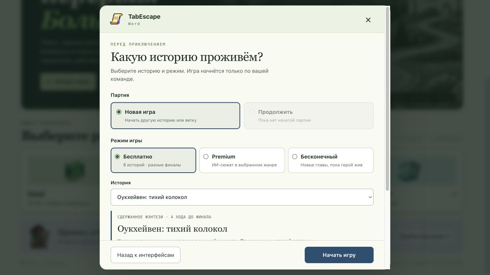
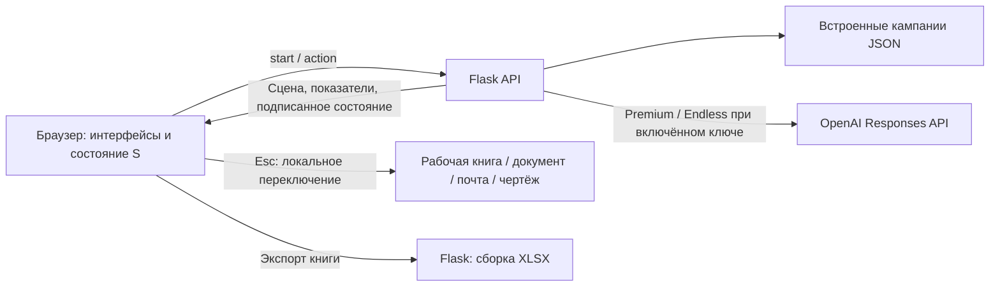

<div align="center">
  
  <h1>TabEscape</h1>
  <p><strong>Короткое приключение в привычном рабочем окне</strong></p>
  <p><a href="https://github.com/ruslan-berkin/project4zimran/actions/workflows/ci.yml"></a></p>
  <p>Браузерная текстовая RPG · 8 бесплатных историй · 4 офисных интерфейса · RU / EN</p>
  <p><a href="#установка-и-запуск">Запустить</a> · <a href="#как-проверить-решение">Проверить демо</a> · <a href="PITCH.md">Материал для питча</a> · <a href="docs/REVIEW.md">Проверка репозитория</a></p>
</div>



## О проекте

**TabEscape** — B2C-развлечение в браузере для короткого перерыва между рабочими задачами. Целевая аудитория проекта — офисные сотрудники 25–45 лет в США. Продукт отвечает на ситуацию: «У меня несколько свободных минут; хочу сделать пару ходов и быстро вернуться к документу».

Игрок выбирает офисное оформление, историю и действия героя. Нажатие **Esc** открывает подготовленный рабочий экран, повторное нажатие возвращает в ту же сцену. Русский и английский интерфейсы позволяют показать демо разной аудитории. Для бесплатного сценария не нужны регистрация, свой файл или ключ ИИ.

Проект подготовлен как демонстрация для хакатона в треке **Entertainment**. Проверенных данных о спросе, удержании или выручке пока нет; бизнес-допущения вынесены в [PITCH.md](PITCH.md).

## Что реализовано

### Четыре оформления одной игры

| Интерфейс | Игровое представление | Рабочий экран по Esc |
|---|---|---|
| **Excel** | Сетка со сценой, вариантами хода и показателями | Заполненный Q4-отчёт либо книга пользователя: ячейки, формулы, листы, форматирование, экспорт `.xlsx` |
| **Word** | Страница документа с боковыми показателями | Редактируемый документ с лентой и базовым форматированием; скачивание HTML |
| **Outlook** | Папки, список и область чтения сюжета | Демонстрационные письма, которые можно выбрать и прочитать |
| **AutoCAD** | Чертёжная область и блоки приключения | Локальный браузерный план с масштабом и переключением слоя мебели |

После выбора **любой** маски открывается подготовка партии: новая игра или продолжение, история, режим и обучение. Игра начинается только после подтверждения. При новом открытии сайта кнопка запуска по умолчанию выбирает Excel.

### Библиотека и механика

| Бесплатная история | Жанр |
|---|---|
| Оукхейвен: тихий колокол | Сдержанное фэнтези |
| Строка 17 | Детектив |
| Смотритель последнего маяка | Мистика |
| Шестая палата | Хоррор |
| Орбита без связи | Научная фантастика |
| Перевал до снегопада | Экспедиция |
| Письмо через осаду | Историческое приключение в вымышленном мире |
| Последний поезд | Триллер |

В каждой истории есть развилки, сбор сведений, предмет и разные финалы. Обычный путь занимает четыре выбора; использование предмета и собственное действие тоже считаются ходом. Рискованные действия могут завершить приключение раньше.

Реализованы три варианта действия, собственный ход, здоровье, бодрость, неприятности, инвентарь, журнал, график здоровья, рекорд, повторная игра и скачивание дневника. Ход добавляет 30 игровых минут. Новые кампании завершаются по сюжету или состоянию героя, а не автоматически в 18:00.

Проводница Мира объясняет интерфейс, позволяет сделать настоящий ход и попробовать переключение. Обучение можно пропустить и повторить. Верхняя панель сворачивается; для мыши и сенсорного экрана есть кнопка переключения.

### Premium и бесконечный режим

- **Без ключа:** Premium показывает готовую историю выбранного жанра с подписью «демо без ИИ». Бесконечный режим повторяет локальные главы до гибели героя — это не генерация новых сюжетов.
- **При включённом OpenAI:** сервер запрашивает новые сцены и действия, передаёт модели память событий, последние ходы, показатели и инвентарь. Для Premium задан ориентир завершённой арки на 8–12 ходов; в бесконечном режиме окончание от модели игнорируется, пока герой жив.
- После трёх завершений за день появляется предложение будущей подписки. Оно **не блокирует игру**. Оплата и проверка подписки не подключены.

## Как работает решение

1. Игрок открывает сайт и выбирает язык и офисный интерфейс.
2. В окне подготовки выбирает историю, режим и необходимость обучения. Для Excel можно дополнительно открыть свою рабочую книгу; это необязательно.
3. Кнопка запуска вызывает `/api/start`. Сервер возвращает сцену, показатели, три действия и подписанное состояние партии.
4. Выбранное или введённое действие отправляется в `/api/action`. Сервер рассчитывает последствия встроенным движком либо запрашивает OpenAI для включённых ИИ-режимов.
5. Браузер показывает новую сцену, время, показатели и запись журнала.
6. Esc или экранная кнопка переключает представление без перезагрузки и без нового игрового API-запроса. Повторное переключение возвращает ту же партию.

При смене маски можно продолжить текущую историю. Правки рабочего экрана сохраняются в пределах текущей вкладки. Ответ хода, пришедший во время работы с документом, показывается после возвращения к игре.

## Технологии

| Компонент | Используется в репозитории |
|---|---|
| Сервер | Python, Flask, Gunicorn |
| Клиент | HTML, CSS, обычный JavaScript без фронтенд-фреймворка |
| HTTP и конфигурация | `requests`, `python-dotenv` |
| Проверка состояния | Подпись через `itsdangerous`, поставляемый с Flask |
| Истории | Локальный JSON с русскими и английскими текстами |
| Excel | Клиентский разбор и вычисление поддерживаемых формул; серверная работа с OOXML через `zipfile` и `xml.etree.ElementTree` |
| ИИ | OpenAI Responses API, JSON Schema / Structured Outputs; модель по умолчанию `gpt-5-mini` |
| Проверки | Python `unittest`, имитация ответов ИИ, проверка синтаксиса JavaScript, `pip-audit` |
| Развёртывание | `Procfile` и конфигурация Render в `render.yaml` |

В коде также сохранён прежний путь Groq/Gemini для совместимости старого API. Текущий интерфейс новых кампаний использует встроенный движок или OpenAI. База данных, аккаунты и платёжный сервис отсутствуют.

## Архитектура проекта



```text
.
├── README.md                  # Обзор для жюри и быстрый запуск
├── PITCH.md                   # Сценарий питча и бизнес-гипотезы
├── .env.example               # Шаблон серверных настроек без ключей
├── render.yaml                # Конфигурация хостинга
├── .github/                   # CI, шаблоны issues и pull requests
├── docs/                      # Итоги ревью, происхождение ресурсов, скриншот
├── TabEscape (2).html          # Самостоятельный исторический референс
└── tabescape_app/
    ├── app.py                 # API, движки, экспорт XLSX, резервные ресурсы
    ├── templates/index.html   # Обслуживаемая страница Flask
    ├── static/
    │   ├── js/                # Игра, маски, обучение, локализация
    │   ├── css/               # Оформление и адаптивная компоновка
    │   ├── data/              # Кампании и демонстрационная книга
    │   └── images/            # Локальные изображения интерфейса
    ├── scripts/embed_assets.py
    ├── tests/                 # Проверки API, историй и восстановления
    ├── requirements.txt
    └── Procfile
```

Канонические файлы интерфейса — `templates/` и `static/`. `_EMBEDDED_FILES` в `app.py` содержит резервную копию для восстановления отсутствующих ресурсов. После изменения интерфейса её нужно обновлять скриптом. Корневой `TabEscape (2).html` не является точкой запуска Flask.

## Установка и запуск

Нужны Git и Python 3.11 или 3.12. Команды ниже рассчитаны на macOS/Linux.

```sh
git clone https://github.com/ruslan-berkin/project4zimran.git
cd project4zimran/tabescape_app
python3 -m venv .venv
source .venv/bin/activate
pip install -r requirements.txt
```

При первом запуске создайте конфигурацию:

```sh
cp .env.example .env
python app.py
```

Откройте **[http://localhost:5050](http://localhost:5050)**. Шаблон `.env` задаёт порт 5050; без файла используется 5000. Если порт занят:

```sh
PORT=5051 python app.py
```

Для бесплатной библиотеки оставьте ключ пустым и `OPENAI_ENABLED=false`.

### Подключение OpenAI

В **`tabescape_app/.env`**, а не в HTML или JavaScript, задайте:

```dotenv
OPENAI_API_KEY=ваш_ключ
OPENAI_MODEL=gpt-5-mini
OPENAI_ENABLED=true
TABESCAPE_SECRET_KEY=постоянный_случайный_секрет
PORT=5050
```

Секрет подписи создаётся один раз:

```sh
python -c 'import secrets; print(secrets.token_hex(32))'
```

Перезапустите сервер, обновите страницу и начните новую игру в Premium или бесконечном режиме. Ключ остаётся на сервере; `.env` исключён из Git. Бесплатные истории не вызывают OpenAI даже при подключённом ключе. Проверки репозитория используют имитации ответов; успешная генерация с реальным ключом команды пока не подтверждена.

### Запуск через Gunicorn

Из `tabescape_app`:

```sh
gunicorn app:app --timeout 60 --bind 0.0.0.0:8000
```

Для нескольких процессов задайте одинаковый `TABESCAPE_SECRET_KEY`; иначе подписанное состояние разных процессов будет несовместимо. Проверка доступности сервера: `GET /healthz`.

## Как проверить решение

Сценарий для жюри без аккаунта, собственного файла и ключа:

1. Откройте сайт, при необходимости переключите язык на русский.
2. Выберите **Excel**. Убедитесь, что сначала открылось окно подготовки.
3. Выберите **Бесплатно → Оукхейвен: тихий колокол**, включите обучение и начните игру.
4. Сделайте один из предложенных ходов. Время изменится с **09:00 на 09:30**; выбор отразится в сцене, показателях и журнале.
5. На шаге переключения нажмите **Esc**: откроется заполненный Q4-отчёт. Повторный Esc вернёт ту же сцену. В начале обучения Esc пропускает подсказки; переключение также доступно экранной кнопкой.
6. В рабочем Excel выберите B2, измените `125000` на `130000` в строке формул и нажмите Enter. Значение D2 изменится с `15000` на `10000`. Выгрузите `.xlsx`.
7. Через **Маски** выберите **Word → Продолжить**. История, время и журнал сохранятся. Нажмите Esc, отредактируйте рабочий документ и переключитесь туда и обратно: правка останется.
8. Попробуйте другую бесплатную историю или Premium / бесконечный режим. Без ключа последние два явно обозначены как демо.

В настройках Esc закрывает диалог; во время ввода формулы отменяет редактирование. Для узкого экрана используйте кнопку переключения.

### Автоматические проверки

Из `tabescape_app`:

```sh
python -m unittest discover -s tests -v
gunicorn app:app --check-config --timeout 60
```

После изменения ресурсов:

```sh
python scripts/embed_assets.py
```

Тесты проверяют финалы всех восьми историй на двух языках, показатели, инвентарь, бесконечный режим, обработку ошибок ИИ, экспорт книги, резервное восстановление и ошибочные запросы. Подробности и границы проверок — в [отчёте ревью](docs/REVIEW.md) и [журнале браузерных проверок](tabescape_app/VERIFICATION.md).

## Данные и интеграции

- `static/data/campaigns.json` — восемь встроенных историй RU/EN. `story-en.json` относится к прежнему движку.
- `static/data/Книга1.xlsx` — демонстрационный отчёт. При ошибке чтения доступен встроенный прогноз; книга пользователя имеет приоритет.
- Документ Word, письма Outlook и чертёж AutoCAD — локальные демонстрационные данные, без подключения к рабочим аккаунтам.
- OpenAI получает контекст истории только при включённой генерации; используется `store:false`. Параметры и интеграция описаны подробнее в [техническом README](tabescape_app/README.md#premium-и-openai).
- При экспорте Excel браузер передаёт Flask-серверу книгу и правки. Лимит тела API-запроса — 16 МиБ, включая JSON и кодирование файла.
- Происхождение изображений и статус прав описаны в [ASSETS.md](docs/ASSETS.md).

## Ограничения текущей версии

- Партия, журнал и рабочие правки сохраняются **только до перезагрузки текущей вкладки**. Язык, обучение, скрытие панели и рекорд сохраняются в браузере. Загрузки сохранённой партии нет.
- Нет аккаунтов, оплаты, серверной проверки подписки и ограничения расходов на ИИ для коммерческого доступа. Демо не блокируется после трёх историй.
- Без OpenAI бесконечный режим повторяет локальные главы. Качество длинных ИИ-партий и работа с реальным ключом команды ещё требуют проверки.
- Это офисные маски, а не полные аналоги Microsoft Office или AutoCAD. DWG не импортируется; Word экспортирует HTML, а не DOCX.
- Excel принимает `.xlsx`, `.csv`, `.tsv`, `.txt`; бинарный `.xls` не поддерживается. Доступно подмножество формул; неподдерживаемые импортированные формулы могут показывать кэш Excel.
- Интерфейс, новые истории, действия и подсказки переведены на RU/EN; рабочие демонстрационные материалы преимущественно английские.
- Архитектура сохраняет монолитные `app.py` и `app.js` и прежний движок совместимости. Дальнейшее разделение модулей — отдельная задача.
- Лицензия проекта не выбрана, права на распространение предоставленного командой оформления требуют подтверждения. Это не заявление об аффилированности с производителями офисных приложений.

## Публичная версия и материалы для подачи

**Подтверждённой deployed-ссылки в репозитории пока нет.** `render.yaml` готовит Flask-сервис к развёртыванию на Render, но наличие конфигурации не означает, что сайт уже опубликован. Для развёртывания создайте Blueprint из репозитория в аккаунте команды; настройки ключа задаются в окружении сервиса.

- [Публичный GitHub](https://github.com/ruslan-berkin/project4zimran) — исходный код и инструкции.
- [PITCH.md](PITCH.md) — материал для пяти минут питча и демонстрации, с явно обозначенными бизнес-гипотезами.
- Готовая PDF-презентация и публичная рабочая ссылка пока отсутствуют в репозитории.

Для дальнейших изменений см. [CONTRIBUTING.md](CONTRIBUTING.md).
